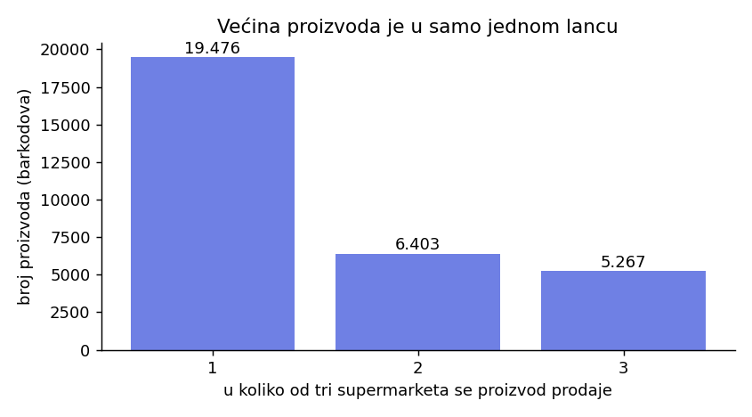
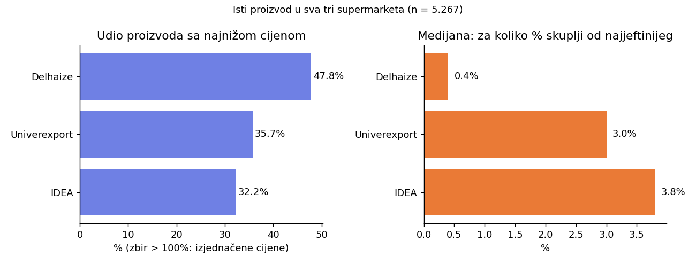
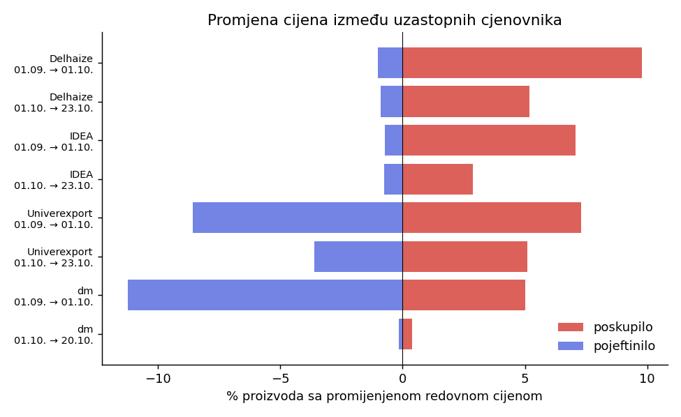
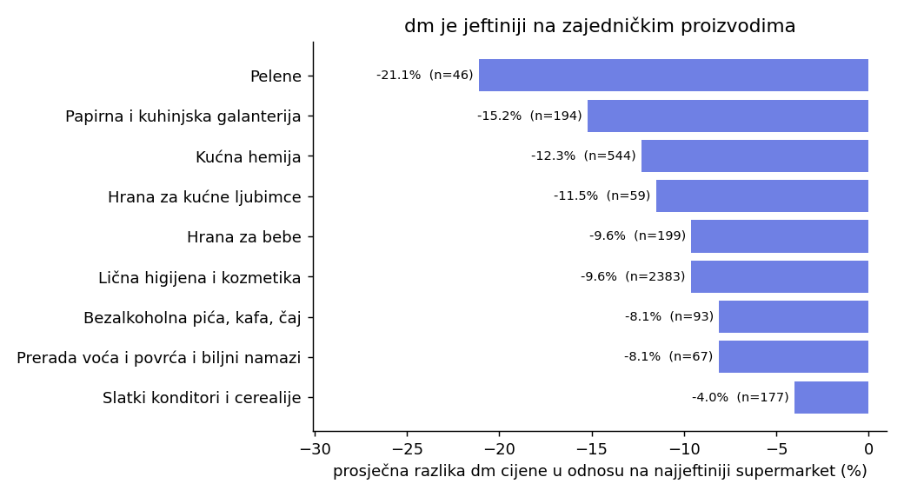

# Cijene u srpskim maloprodajnim lancima: SQL analiza otvorenih podataka

Autor: Matea Masleša

Projekat analizira cjenovnike četiri maloprodajna lanca u Srbiji (Delhaize/Maxi, IDEA, Univerexport i dm) koje su trgovci dužni da objavljuju kao otvorene podatke. Podaci su očišćeni, složeni u relacionu bazu sa više povezanih tabela i analizirani SQL upitima: poređenje cijena istih proizvoda među lancima, promjena cijena kroz vrijeme i poređenje drogerije (dm) sa supermarketima.

## Podaci

- **Izvor:** Portal otvorenih podataka (data.gov.rs), skupovi *Cjenovnici proizvoda prema Pravilniku o uslovima, sadržaju i načinu objavljivanja cjenovnika*, po jedan za svakog trgovca. Linkovi su u [`data/README.md`](data/README.md).
- **Licenca:** Srpska licenca za otvorene podatke (obavezno navođenje izvora i datuma preuzimanja). Preuzeto 23.10.2026.
- **Obim:** 457.348 redova, 15 kolona u sva četiri fajla, tri cjenovnika po trgovcu: mjesečni presjeci od 1.9. i 1.10.2026. i važeći cjenovnik (20. i 23.10.2026.).
- Sirovi podaci **nisu u repozitoriju**; skripte ih učitavaju iz `data/raw/`.

## Baza podataka

Zvjezdasta šema: dimenzije i jedna tabela činjenica.

| Tabela | Sadržaj |
|---|---|
| `trgovac` | 4 trgovca i tip (supermarket ili drogerija) |
| `format_prodavnice` | 12 formata (Maxi, Mega Maxi, MERCATOR, RODA...) |
| `kategorija` | zajednička šifra od 25 kategorija |
| `proizvod` | jedan red po barkodu (zajednički ključ među lancima) |
| `cjenovnik` | trgovac + datum + vrsta cjenovnika |
| `cijena` | tabela činjenica: cijena po formatu, cjenovniku i proizvodu |
| `kvalitet_log` | evidencija čišćenja |

## Čišćenje podataka

Učitano 457.348 redova, u bazi ostaje 456.538. Sve odluke su zabilježene u tabeli `kvalitet_log`:

| Problem | Trgovac | Redova | Odluka |
|---|---|---|---|
| barkod u više kategorija | svi | 519 | uzeta najčešća kategorija |
| duplikat sa različitim cijenama | Univerexport | 33 | uklonjeno (ne znamo koja je tačna) |
| nepoznata jedinica mjere | dm | 6 | grupa ostaje NULL |
| potpuni duplikat | Delhaize | 12 | ostavljen jedan red |
| red bez barkoda | Delhaize | 15 | uklonjeno (proizvod se ne može povezati) |
| redovna cijena prazna ili 0 | Delhaize | 3 | uklonjeno (nema smislene cijene) |
| redovna cijena prazna ili 0 | Univerexport | 747 | uklonjeno (nema smislene cijene) |
| snižena cijena = 0 | Univerexport | 131.007 | pretvoreno u NULL (nema sniženja) |
| snižena cijena >= redovne | IDEA | 109 | pretvoreno u NULL (greška u podacima) |
| snižena cijena >= redovne | dm | 2 | pretvoreno u NULL (greška u podacima) |

Dodatno: jedinice mjere (kg, KG, lit, L, kom, 1kom, 100ml...) razvrstane su u grupe (masa, zapremina, komad, dužina), uz zadržanu izvornu vrijednost.

## Metodološke odluke

- **Format prodavnice mijenja cijenu.** Maxi, Maxi Online i Mega Maxi imaju gotovo iste cijene (manje od 1% razlike), a Profi (oko 5% jeftiniji) i Shop and Go (oko 4% skuplji) odstupaju. Zato se poredi po **jedan standardni format** po lancu: Mega Maxi, IDEA i UNIVEREXPORT - M (srednji format po cijenama).
- **dm je drogerija.** Ima 76% asortimana u kategoriji lične higijene i kozmetike, a samo 25% njegovih proizvoda postoji i u nekom supermarketu. Zato se **supermarketi međusobno porede po svim kategorijama, a dm odvojeno**, samo na zajedničkim proizvodima.
- Poređenje se radi **po barkodu** (isti proizvod, isto pakovanje) i po **redovnoj cijeni**.

## Rezultati

### Koji proizvodi se mogu porediti
Od 31.146 proizvoda u tri supermarketa, njih **5.267** se prodaje u sva tri, 6.403 u dva, a 19.476 u samo jednom.



### Ko je najjeftiniji (samo proizvodi u sva tri supermarketa)
Za 5.267 zajedničkih proizvoda: **Delhaize** je imao najnižu cijenu kod 47,8% proizvoda, Univerexport kod 35,7%, IDEA kod 32,2%. Zbir prelazi 100% jer se kod 724 proizvoda najniža cijena poklapa u dva lanca. Razlike su male: medijana je 0,4% (Delhaize), 3,0% (Univerexport) i 3,8% (IDEA) iznad najjeftinije cijene.



### Promjena cijena kroz vrijeme
| Trgovac | Period | Proizvoda | Poskupilo | Pojeftinilo | Promijenjeno |
|---|---|---|---|---|---|
| Delhaize | 01.09. → 01.10. | 10.899 | 1.065 | 109 | 10,8% |
| Delhaize | 01.10. → 23.10. | 10.972 | 568 | 99 | 6,1% |
| IDEA | 01.09. → 01.10. | 19.540 | 1.379 | 140 | 7,8% |
| IDEA | 01.10. → 23.10. | 20.076 | 579 | 153 | 3,6% |
| Univerexport | 01.09. → 01.10. | 16.279 | 1.189 | 1.397 | 15,9% |
| Univerexport | 01.10. → 23.10. | 16.239 | 830 | 587 | 8,7% |
| dm | 01.09. → 01.10. | 15.030 | 754 | 1.688 | 16,2% |
| dm | 01.10. → 20.10. | 15.142 | 60 | 24 | 0,6% |

Ukupno od prvog do posljednjeg cjenovnika:

| Trgovac | Proizvoda | Promijenjeno | Poskupilo | Pojeftinilo | Prosj. promjena promijenjenih |
|---|---|---|---|---|---|
| Delhaize | 11.059 | 16,0% | 1.582 | 183 | 5,1% |
| IDEA | 20.076 | 10,5% | 1.885 | 224 | 7,4% |
| Univerexport | 16.498 | 22,5% | 1.908 | 1.812 | -0,4% |
| dm | 15.285 | 16,4% | 798 | 1.707 | -4,7% |



Delhaize i IDEA su uglavnom poskupljivali, dm je pretežno pojeftinjivao (skoro sve između 1.9. i 1.10.), a Univerexport je imao podjednako poskupljenja i pojeftinjenja. Među kategorijama u supermarketima najviše je poskupjela „Brašno, dodaci za pečenje i kolače i praškasti proizvodi“ (prosječno 2,33%), a jedina sa blagim padom je „Sveža i prerađena riba“ (-0,51%). Pregled ekstremnih promjena pokazuje da dio „skokova“ vjerovatno nisu poskupljenja (npr. „DINJA“ sa 79,99 na 259,99, što je vjerovatno sezonska cijena ili promjena načina vaganja), pa se rezultati moraju čitati oprezno.

### dm naspram supermarketa
Za 3.903 proizvoda koje prodaju i dm i bar jedan supermarket, dm ima **nižu redovnu cijenu od najjeftinijeg supermarketa kod 76,0%** proizvoda (skuplji kod 23,6%). Medijana odnosa dm cijene prema najjeftinijem supermarketu je 0,888.

| Kategorija | Proizvoda | dm jeftiniji | Prosječna razlika |
|---|---|---|---|
| Pelene | 46 | 46 | -21,1% |
| Papirna i kuhinjska galanterija | 194 | 160 | -15,2% |
| Kućna hemija | 544 | 425 | -12,3% |
| Hrana za kućne ljubimce | 59 | 55 | -11,5% |
| Hrana za bebe | 199 | 152 | -9,6% |
| Lična higijena i kozmetika | 2.383 | 1.802 | -9,6% |
| Bezalkoholna pića, kafa, čaj | 93 | 68 | -8,1% |
| Prerada voća i povrća i biljni namazi | 67 | 55 | -8,1% |
| Slatki konditori i cerealije | 177 | 113 | -4,0% |



## Ograničenja

- Podaci pokrivaju **oko sedam sedmica** (tri cjenovnika), pa se ne mogu izvoditi zaključci o dugoročnim trendovima.
- Poredi se samo **jedan format po lancu** i **redovna cijena** (bez sniženja i bez težina prodaje). Rezultat je poređenje **zajedničkih proizvoda**, a ne cijene korpe, pa se ne može reći koji je lanac „najjeftiniji“ uopšte.
- Cijene su na nivou formata, a ne konkretne prodavnice, pa nema poređenja gradova.
- Zajednički proizvodi su vjerovatno popularnije robne marke, što može uticati na poređenje sa dm-om.
- Neke očigledne greške u podacima su obrađene (nule, duplikati), ali sumnjive cijene (npr. 107.565 din za jedan deterdžent) nisu ručno ispravljane.
- Nazivi, jedinice i kategorije dolaze od trgovaca i nisu potpuno ujednačeni.

## Korišćene SQL tehnike

`JOIN` (uključujući spajanje tabele sa samom sobom), `GROUP BY` i `HAVING`, podupiti i `EXISTS`, CTE (`WITH`), pogledi (`VIEW`), uslovno agregiranje (`CASE WHEN`), prozorske funkcije (`RANK`, `ROW_NUMBER`, `LAG`, `MIN() OVER`), čišćenje podataka i projektovanje zvjezdaste šeme.

## Struktura i pokretanje

```
data/        uputstvo za preuzimanje podataka (sirovi fajlovi se ne objavljuju)
sql/mssql/   T-SQL: šema, uvoz podataka i analitički upiti (SQL Server)
sql/sqlite/  šema za SQLite (koristi je Python)
src/         Python skripte (čišćenje i izgradnja baze, izvoz, grafici)
results/     tabele (csv) i grafici (png)
```

**Opcija A: SQL Server (SSMS).** Upiti u `sql/mssql/` pisani su u T-SQL-u.
1. Preuzmi podatke u `data/raw/` (vidi `data/README.md`) i pokreni `python src/01_build_sqlite_db.py`, a zatim `python src/02_export_for_mssql.py` (pravi CSV fajlove u `data/mssql_csv/`).
2. U SSMS-u napravi bazu (`CREATE DATABASE retail;`), pa redom pokreni `00_schema.sql`, `01_import_data.sql` (prvo promijeni putanju u prvom redu), a zatim `02_basics.sql` do `05_dm_vs_supermarkets.sql`.

**Opcija B: Python + SQLite.**
```bash
pip install -r requirements.txt
python src/01_build_sqlite_db.py      # čišćenje i baza db/retail.db
python src/03_results_and_figures.py  # tabele i grafici u results/
```
Skripte se pokreću iz korijena repozitorija.
